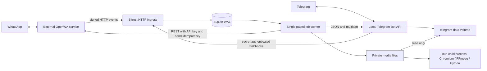

# Current architecture

Investigation baseline: 2026-11-09; repository source, tracked configuration, tests and operational docs. No live credentials, databases or session material were inspected. References are repository-relative, with baseline line numbers. Production implementation was not changed.

Evidence labels throughout these documents: **V** = implemented, established by executable code or tests (does not imply live provider validation); **U** = implemented but external behavior remains unverified here; **D** = documentation only; **N** = no implementation found. Recommendations are proposals, not current behavior.

Bifrost is one Bun process, not one process per contact bot. `src/server.ts:63` constructs configuration, recovering Store and Bridge, binds Node HTTP on all interfaces, then runs one job per timer tick when configured. `src/bridge.ts:107` guards with a process-local busy flag. SQLite selects work and persists receipts. HTTP responds after enqueue, before remote delivery. There is no distributed worker lease: only one process may own this database.

`src/store.ts:10` creates six tables: kv, jobs, effects, messages, aliases and telegram_messages. WAL and a 5-second busy timeout are used. Queue streams enforce order and block behind pending, running, uncertain or failed predecessors. Live WhatsApp jobs for a conversation wait behind its active history import. Priority is ordinary jobs, sync/status, controls, history; this is not strict global arrival ordering (`store.ts:58`).

Provider adapters use native fetch, FormData and node:fs openAsBlob; there is no Telegram SDK or embedded OpenWA client (`src/api.ts:1`). OpenWA uses `/api/sessions/{encoded session}/...`, X-API-Key, and Idempotency-Key for supported outgoing sends. Its pinned implementation is `rmyndharis/OpenWA`, version 0.29.1, commit in `deployment.lock.json:19`, using whatsapp-web.js. Treat this as the actual integration contract; compatibility with unrelated OpenWA distributions is U.

Telegram uses a local Bot API server pinned to 10.3 and a specific tdlib commit (`deployment.lock.json:25`). One manager credential comes from environment; managed credentials are encrypted in SQLite. Owner-only dispatch coordinates all bots (`bridge.ts:83`). A managed bot represents a WhatsApp contact, not a separate logged-in WhatsApp account. One configured WhatsApp account/session is served per process.

## Startup and boundaries

Setup is an explicit CLI (`scripts/setup.ts:9`): require OpenWA ready, log manager out of hosted Telegram API once, verify private management forum and Manage Topics permission, install manager/member webhooks, merge OpenWA subscriptions, queue Status startup. Authentication/QR linking and reconnection belong to external OpenWA. Bifrost has no QR login, WebSocket client, Telegram getUpdates loop or automatic OpenWA reconnect controller (N). Session events produce notices (`bridge.ts:298`).

Runtime startup (`server.ts:63`) validates configuration and recovers queue/effects; indexes old message history for controls, queues menus for migrated bots and Status startup. It does not run full setup on every launch. Hourly media cleanup and 15-second cron checks accompany paced delivery. SIGINT/SIGTERM stop timers and HTTP acceptance, wait for busy work, close SQLite, and force exit after 10 seconds (`server.ts:76`). This can interrupt a 120-second API request; receipt uncertainty is deliberate.

Compose runs Bifrost and Telegram API, joins an external OpenWA network, binds bridge HTTP to host loopback, and mounts bridge-data, bridge-media and read-only telegram-data (`compose.yaml:1`). OpenWA session volumes remain external to this Compose stack. Docker installs Chromium, FFmpeg and a Python venv with Pillow; Bun is 1.4.2, lottie-web 5.13.0, puppeteer-core 25.16.0. TypeScript types are development dependencies (`package.json:1`, `Dockerfile:1`). Linux codec versions are recorded, not independently revalidated here.

Configuration is defined in `src/config.ts:12`: port 3210, local SQLite/media defaults, 100 MiB attachment cap, 1100 ms pace, history default 20 clamped to 0–2000, hourly sync in Asia/Kolkata, command TTL 60 seconds, interactive TTL 600 seconds. Keys/admin/webhook secret are required at startup; configured delivery additionally requires manager token, owner, management group, OpenWA API key and session (`bridge.ts:927`). Preserve names/defaults and validation, including cron parsing (`src/cron.ts:1`). Local start explicitly loads bridge.env; the proposed bare nbb command must receive equivalent environment loading.

Operational scripts cover configure/setup, identification, callback allowlisting, queued sync, group controls, uncertain-send review, repository privacy audit and Docker volume export/import. Export/import is a stopped-service operation preserving encryption, identity, receipt ledger and Telegram local files; see `scripts/transfer.ts:1`, `scripts/transfer-volume.py:1` and `docs/MOVING.md`. No active n8n service exists; old n8n queue jobs convert to management jobs (`bridge.ts:123`).

## Investigation validation

On Bun 1.4.2 macOS arm64, default suite: 229 passed, 11 opt-in skips, 5 HTTP failures under sandbox loopback restrictions. Re-running all six HTTP tests outside the sandbox: 6 passed, 0 failed. Thus all default tests passed across those runs; codec and Docker tests remain unexecuted. This establishes local contracts, not live account parity. Disposable nbb results and remaining gates are in document 04. No live webhook or send was performed.

Deployment evidence caveat: `docs/CURRENT-DEPLOYMENT.md:3` describes a separately running legacy Compose service and n8n forwarding. That is D for this investigation, distinct from the current code path. Historical live checks in `VALIDATION.md` are also D here; no running host/image was inspected. CI (`.github/workflows/`, tracked workflow) covers default tests, codec fixtures, repository audit, image build, transfer, configure and Compose validation.

One-time identification tooling uses hosted getUpdates only when no webhook exists (`scripts/identify.ts:4`); this is distinct from runtime update delivery, which is webhook-only. Configure generates missing private secrets once and preserves existing values (`scripts/configure.ts:6`). Transfer rejects other active volume writers and unsafe archives, verifies token decryption/integrity, normalizes only local service paths, and never starts imported services (`scripts/transfer.ts:53`, `scripts/transfer-volume.py:1`).
